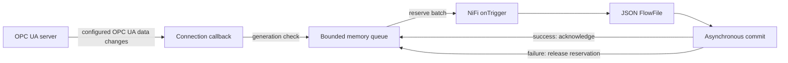

# Architecture

The development NAR registers only `io.github.paf91.nifi.opcua.ConsumeOPCUA` under bundle `io.github.paf91.nifi:nifi-opcua-nar:1.0.5-SNAPSHOT`. The earlier `SubscribeOpcUa` type requires the [processor migration](namespace-migration.md).

## Modules

| Path | Responsibility |
|---|---|
| `processors/src/main/java` | Shared processor lifecycle, tag parsing, identity loading, JSON and buffering; Java 8-compatible |
| `processors/src/main/milo06` | Milo 0.6 adapter for the legacy build |
| `processors/src/main/milo1` | Milo 1 adapter for the modern build |
| `processors/src/test` | Shared tests and version-specific secure server fixtures |
| `nar` | NiFi extension packaging and generated processor documentation |
| `demo` | Standalone local OPC server; never bundled in the NAR |
| `scripts` | Artifact, publication, formatting and demo utilities |

## Data path

The source accepts no incoming connections and exposes `success` for data and an optional, default-disabled `diagnostics` relationship for health reports. Bad-quality data is still data; setup errors are reported through retry/bulletin behavior rather than an error FlowFile relationship.

## Ownership and concurrency

`@OnScheduled` prepares a buffer. `onTrigger` checks cluster ownership before connecting. Role notifications recheck NiFi's current connected/primary state instead of caching the event, so a delayed revocation cannot disable a re-elected primary. Loss of ownership closes the connection. A lifecycle lock serializes triggers and buffer configuration. A separate connection lock controls transport publication and cleanup, so Stop/revocation can cancel and close a connection during a blocked repository write. An opener that finishes after cancellation closes its result instead of publishing it. Encoding runs outside the cancellation monitor; only short state updates and final queue admission use that fence. Late callbacks cannot enqueue into a cancelled generation.

The notification queue is synchronized. It can hold one reserved batch at a time, and overflow never evicts that batch. Commit callbacks capture their original queue, so stop/start and later configuration changes do not acknowledge the wrong records. The old endpoint and channel security policy/mode are held separately from newly configured properties until old data has drained. `OpcSecurity` shares exact endpoint/token selection across the Milo adapters; client identity and trust-store creation depend on the selected channel and token protection. The version-specific `OpcValue` adapter streams Milo 1 matrix elements as nested JSON arrays without constructing intermediate nested Java arrays.

The guarded delivery attempt includes reservation acquisition and commit submission. A synchronous failure before submission rolls back the session before releasing its batch and diagnostics reservations. Cleanup failures are suppressed on the original failure.

The processor extends NiFi's `AbstractSessionFactoryProcessor` to retain a session factory for stop-time delivery. Each session remains owned by one thread. `@OnUnscheduled` closes ingress without waiting for repository I/O. `@OnStopped` starts at most one `StopDrain` worker and waits only to its deadline. The worker uses the same `NotificationBatch` writer as normal triggers, checks ownership/backpressure between batches, and waits for an existing reservation before claiming more work. A timed-out worker cannot be replaced until it actually exits. Start/removal cancels it; a submitted commit still owns its reservation until the callback reports its outcome. Expiry never triggers concurrent rollback of someone else's session.

Notification encoding writes fixed JSON fields directly without allocating a per-record map or a general-purpose formatter for UInt32 status codes. Diagnostics retain timestamps as `Instant` values and format them only when taking a report snapshot. The output field order, status/quality representations and ISO timestamps remain compatible.

Each connection owns a one-thread Netty event loop. Shutdown requests an orderly disconnect, then closes the owned group, including unfinished handshakes. Either adapter constructor closes its owned resources on `Exception` or `Error`, preserving the original failure and suppressing cleanup failures. Shared Milo executors are not globally released by an individual processor. PKI-directory watchers are closed with their connection. Synchronous modern monitored-item setup uses a guarded cancellation interrupt that is cleared before returning a reusable NiFi worker.

## Identity and trust sources

Shared identity loading selects PEM/DER files or a JKS/PKCS12 store. Both routes apply the same client-certificate validity, RSA size, URI and key-match checks. Store selection requires an explicit alias when multiple private-key identities exist. Store and private-key passwords are independent, and owned password arrays are cleared on every loading exit. Clearing these arrays does not erase NiFi strings or all provider copies.

Version-specific trust-manager adapters expose a read-only store snapshot through each Milo API. Only trusted-certificate entries supply anchors. An optional owned PKI-directory manager supplies issuer certificates and both CRL lists, while its trusted certificates are excluded in store mode. Store loading does not import entries into that directory or modify store files. PKI initialization prepares the required directory layout before opening the manager. Modern manager initialization closes the partially initialized manager if initialization fails. Directory watchers retain their existing lifetime and close with the connection. Full and Certificate retain their validation checks; None avoids opening trust material.

Identity and truststore snapshots belong to one processor connection. A new connection reads the files again, but an ordinary Milo reconnect can reuse the existing snapshots. Stop/replace/Verify/Start is the deterministic rotation procedure. Local file parsing and password-based key recovery are not bounded by the OPC Request Timeout.

## Boundaries

Local buffering is intentionally in-memory and bounded by record count and serialized bytes. Batches reserve both records and their bytes until commit; their JSON array size also respects the original buffer configuration. There is no replicated state, durable input journal or OPC history reader. A primary switch can overlap with a previously committed batch and a new subscription's initial values; downstream exactly-once behavior is outside this component's contract.

## Session-specific tags and monitoring

`TagAddress` stores the configured numeric or URI address without a live namespace index. `TagResolver` reads the current NamespaceArray, resolves URI addresses, and rejects duplicate numeric targets before monitored-item creation. Each callback captures an immutable resolved tag. A different Milo session triggers a full connection rebuild when namespace-URI tags or selected cached metadata need refreshing. Late callbacks from the old connection add no records. Numeric addresses remain explicit indexes. No address is inferred from a tag alias.

Deadbands use the server's DataChangeFilter with StatusValue trigger. Rejected filters fail setup. The processor does not silently implement a second client-side filter or compensate with historical reads.

`ConnectionDiagnostics` stores bounded metadata and local activity timestamps separately from measurements. Verification owns a temporary connection; normal triggers optionally serialize the current report into a separate FlowFile. Data and health reports produced by a trigger commit together. A pending report suppresses duplicate report scheduling; commit callbacks capture the original report schedule, so an old completion cannot delay reports after Stop/Start. Session callbacks and diagnostics use the same cancellation fence as data callbacks.

## Output and scheduling configuration

Each NotificationBuffer owns an immutable OutputSettings snapshot. Callbacks use that snapshot for projection and routing; NotificationBatch uses the same snapshot for framing and attributes during both scheduled and stop-time delivery. Retained records therefore cannot be reinterpreted after a configuration change. Each measurement batch reserves consecutive queued records for one destination relationship, preserving queue order and record/byte accounting.

Delayed-batch readiness uses queue count, serialized bytes and one counter of adjacent route transitions. Appends and acknowledgements maintain that counter, so readiness checks take constant time without rescanning a growing partial batch. Age and buffer pressure still flush early, and batch reservation still selects the contiguous head route with JSON array or NDJSON framing.

NotificationJson writes primitive values directly and uses specialized primitive-array loops. NodeId display text is cached per resolved TagDefinition, with a size guard before materialization. Byte/depth limits and precision-preserving Int64/UInt64/nonfinite representations remain enforced. No pooled oversized payload buffers are introduced.

A pending reservation is waited on for at most 50 ms per active trigger; the commit callback wakes waiters. A partial batch can use the remaining wait budget for optional linger. A queued or committing batch does not request NiFi's full yield. Empty queues still yield. Zero-period scheduling cannot spin continuously on these pending states, and stop cancellation is not blocked by an unbounded batch/commit wait.

Optional TagMetadataReader requests run during connection setup. Adapters supply asynchronous read and browse-path operations plus static built-in EUInformation decoding. Shared code normalizes each response batch before retaining results, enforces one overall metadata deadline, and checks cancellation. New sessions recreate subscriptions when namespace URIs or cached metadata require refreshing. Metadata changes within the same session are not monitored.
